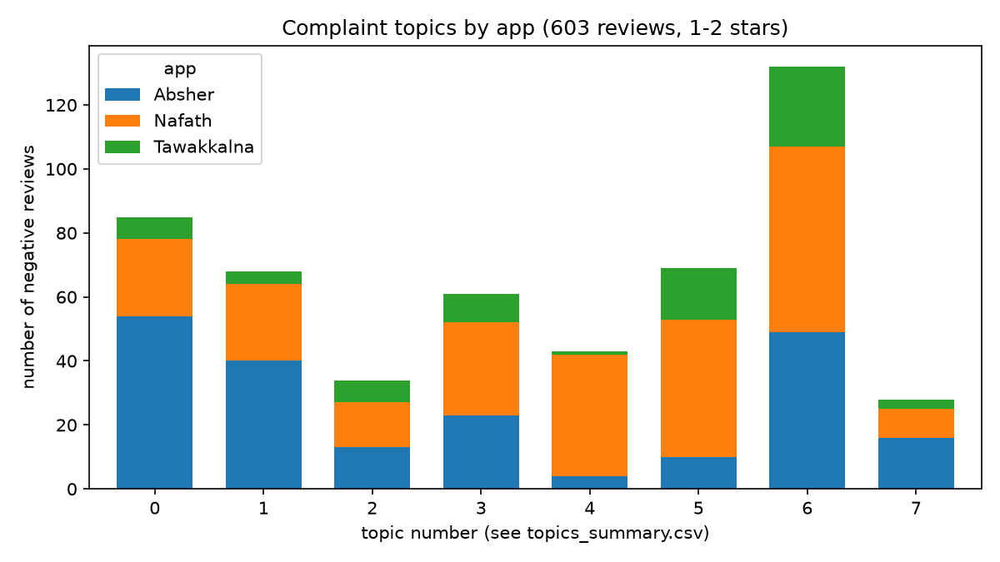

# تحليل مشاعر ومواضيع تقييمات التطبيقات السعودية (Arabic NLP)

مشروع يحلل تقييمات تطبيقات أبشر وتوكلنا ونفاذ على Google Play: يقيس المشاعر، ويستخرج مواضيع الشكاوى، ويحولها إلى متطلبات تحسين مرتبة بالأولوية.

## السؤال
ما الذي يزعج مستخدمي التطبيقات الحكومية السعودية؟ وكيف نحوّل التقييمات إلى متطلبات قابلة للتنفيذ؟

## أهم النتائج

- **النجوم لا تساوي المشاعر.** في عينة من 300 تقييم صُنفت حسب المعنى، كان الاتجاه معاكسًا للنجوم في 29 تقييمًا (حوالي 10%): تقييمات 4 أو 5 نجوم مكتوب فيها شكوى، وتقييمات بنجمة أو نجمتين مكتوب فيها مدح.
- **نموذج TF-IDF بسيط يتفوق على النجوم:** Macro-F1 = 0.932 مقابل 0.868 للنجوم وحدها.
- **النموذج العربي الجاهز (CAMeLBERT) مماثل للنموذج البسيط:** 0.942، لكن الفرق (+0.009) غير موثوق إحصائيًا (فاصل ثقة 95%: من -0.034 إلى +0.049).
- **الشكاوى تدور حول اعتمادية التطبيق:** الفتح، وبيانات الجوال، والتحديثات تمثل 47% من الشكاوى السلبية، والدخول والتحقق وكلمة المرور 29%.



## البيانات

| | |
|---|---|
| المصدر | Google Play (المتجر السعودي، اللغة العربية)، جُمعت في 4 أكتوبر 2026 |
| التطبيقات | أبشر (`sa.gov.moi`)، توكلنا (`sa.gov.nic.twkhayat`)، نفاذ (`sa.gov.nic.myid`) |
| الحجم | 9000 تقييم خام (أحدث 3000 لكل تطبيق)، بقي 8561 بعد التنظيف |
| الخصوصية | حُذفت أسماء المستخدمين وصورهم عند الجمع |

التقييمات الخام غير مرفوعة في المستودع لأنها نصوص كتبها مستخدمون؛ يمكن إعادة جمعها بالسكربت.

## المنهجية

| الملف | ما يفعله |
|---|---|
| `01_scrape_reviews.py` | يجمع التقييمات من Google Play |
| `02_clean_text.py` | تطبيع النص العربي (التشكيل، التطويل، تكرار الحروف، همزات الألف)، وإنشاء عينة 300 تقييم متساوية من كل نجمة للتصنيف |
| `03_baseline_model.py` | نموذج TF-IDF (كلمات وحروف) + Logistic Regression، يُدرَّب على النجوم ويُقاس على التصنيف حسب المعنى |
| `04_topics.py` | استخراج مواضيع الشكاوى بطريقة TF-IDF + NMF على التقييمات السلبية |
| `05_user_stories.md` | تحويل المواضيع إلى متطلبات و User Stories بأولويات MoSCoW |
| `06_arabic_model.py` | مقارنة نموذج CAMeLBERT العربي (بدون تدريب إضافي) مع النموذج الأساسي |

## النتائج التفصيلية

### تقييم المشاعر
تقاس النماذج على 260 تقييمًا (173 سلبي و87 إيجابي) من العينة المصنفة. استُبعد 40 تقييمًا من الـ300 (29 محايدًا و11 غير مفهوم) لقلتها.

| الطريقة | Macro-F1 |
|---|---|
| النجوم وحدها | 0.868 |
| TF-IDF + Logistic Regression | 0.932 |
| CAMeLBERT (جاهز) | 0.942 |

- أخطاء النموذج الأساسي: 16 من 260 (12 سلبيًا عدّها إيجابيًا، و4 العكس). أغلب الـ12 شكاوى قصيرة أو وصفية بلا كلمات الشكوى المألوفة («الأسعار جدًا غالية»، «رجعوا لنا الخلفية البيضاء»)، وثلاثة منها شكاوى مهذبة فيها سلام أو شكر.
- أخطاء النموذج العربي: 14، كلها تعليقات سلبية عدّها إيجابية. اختار «محايد» كأعلى خيار في 28% من التعليقات، والأرجح أن الشكاوى الوصفية بلا لغة انفعالية يراها محايدة (فرضية لم تُختبر).
- النموذجان يخطئان في تعليقات مختلفة: صح العربي وحده في 13، والأساسي وحده في 11، وأخطأ الاثنان في 3.

### مواضيع الشكاوى
603 تقييمًا بنجمة أو نجمتين (ثلاث كلمات فأكثر)، 8 مواضيع، و83 تقييمًا (13.8%) لم يُسنَد لأي موضوع.

| الموضوع | الحصة | ملاحظة |
|---|---|---|
| التحديثات | 21.9% | موزعة على التطبيقات الثلاثة بنسبها |
| التطبيق لا يفتح | 14.1% | أبشر 64% |
| التحقق بالوجه والتصوير | 11.4% | نفاذ 62% |
| لا يعمل على بيانات الجوال | 11.3% | أبشر 59% |
| تسجيل الدخول | 10.1% | عام |
| كلمة المرور | 7.1% | نفاذ 88% |
| التعليق | 5.6% | عام |
| البطء وتعذر الاتصال | 4.6% | أبشر 57% |

التفاصيل والمتطلبات والأولويات في `05_user_stories.md`.

## القيود

1. **التصنيف بنموذج لغوي:** عينة الاختبار صنفها Claude (نموذج لغوي). راجعتُ بنفسي عينة من 30 تصنيفًا دون الاطلاع على تصنيف النموذج: اتفقنا في 25 (83%)، وفي 24 من 26 تعليقًا إيجابيًا أو سلبيًا (92%)، والاختلاف كان في حالات حدودية (محايد مقابل سلبي أو إيجابي). العينة صغيرة فالنسبة تقريبية، ولم تُراجع المجموعة كاملة، فأرقام Macro-F1 تعني الاتفاق مع تصنيف النموذج وليس مع حكم بشري كامل.
2. **نوافذ زمنية مختلفة:** جُمعت أحدث 3000 تقييم لكل تطبيق، فغطت أبشر 183 يومًا ونفاذ 280 وتوكلنا 86 فقط. لا تُقارن أعداد الشكاوى بين التطبيقات، ولا يُستنتج اتجاه زمني.
3. **عينة الاختبار غير طبيعية:** مأخوذة بالتساوي من كل نجمة، بينما التقييمات الحقيقية حوالي 89% إيجابية.
4. **حجم العينة:** 260 تقييمًا فقط، فالفروق الصغيرة بين النماذج قد تكون صدفة.
5. **«سلبي» في المواضيع يعني نجمة أو نجمتين**، وفيه عدد قليل من التقييمات مضمونها مدح.
6. **أسماء المواضيع تفسيرية** من الكلمات والأمثلة، وليست تصنيفًا بشريًا.
7. **التقييمات تصف العَرَض لا السبب،** وتمثل المتحمسين والغاضبين أكثر من المستخدم العادي.

## ما لم يُنجز

- تحليل التغير عبر إصدارات التطبيق (بياناتنا الحالية لا تغطي فترة كافية).
- تدريب النموذج العربي على بيانات المجال (استُخدم كما هو).
- تطبيق تفاعلي (Streamlit).

## التشغيل

```bash
pip install -r requirements.txt
python 01_scrape_reviews.py     # بعد تعبئة APPS داخل الملف
python 02_clean_text.py
# صنّفي العينة data/label_sample.csv وسمّيها data/label_sample_labeled.csv
python 03_baseline_model.py
python 04_topics.py 8
python 06_arabic_model.py       # أول تشغيل ينزّل النموذج (حوالي 450 ميجا)
```

## الأدوات
Python، pandas، scikit-learn (TF-IDF، Logistic Regression، NMF)، Hugging Face Transformers (CAMeLBERT)، google-play-scraper، matplotlib.
